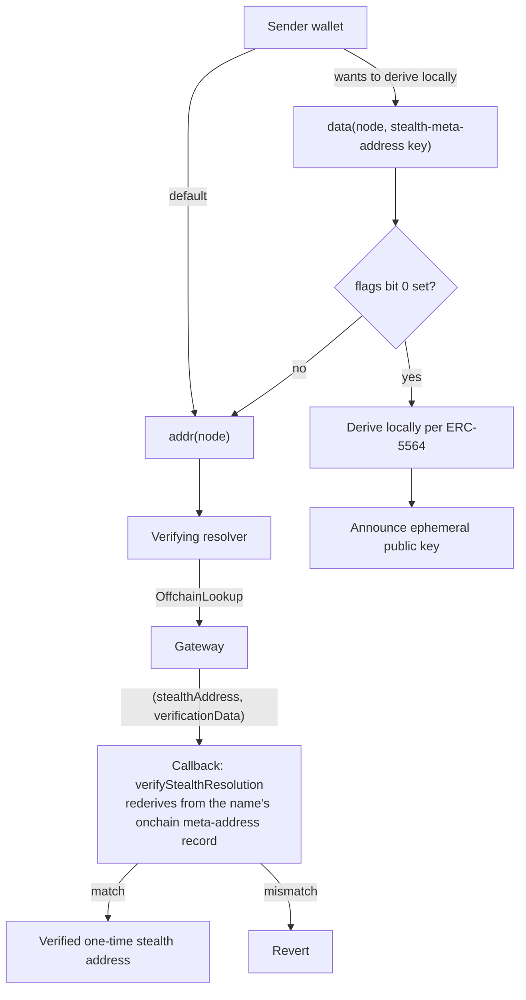

# ENSIP-X: Stealth Address Resolution

## Abstract

This ENSIP specifies how [ERC-5564](https://eips.ethereum.org/EIPS/eip-5564) stealth meta-addresses are published under ENS names, and the resolution semantics under which a name resolves to a fresh, one-time stealth address.

Two resolution paths are defined over the same record:
1. client-side derivation
2. gateway-based resolution via [ERC-3668](https://eips.ethereum.org/EIPS/eip-3668) (CCIP-Read) in which every gateway-provided address is verified onchain against the registered meta-address before resolution completes

## Motivation

An ENS name typically resolves to a single static address, exposing the recipient's complete transaction and account history to anyone who looks the name up. Stealth addresses solve this by letting senders derive a new address for each payment from a published meta-address.

ENS names improve stealth address user experience by allowing for a single human readable identifier while returning a different address per resolution.

This ENSIP defines the standards that:
1. bind a stealth meta-address to an ENS name
2. make gateway-based stealth resolution verifiable onchain, so that a gateway can never return an address that does not derive from the registered meta-address

## Specification

The key words MUST, MUST NOT, SHOULD, and MAY are to be interpreted as described in [RFC 2119](https://www.rfc-editor.org/rfc/rfc2119).

### Overview

The two resolution paths, and where verification happens:



### 1. Meta-address record

The meta-address is published as an [ENSIP-24](https://docs.ens.domains/ensip/24) `data()` record.

**Key**

The record key is the following UTF-8 string:

```
stealth-meta-address[<schemeId>][<coinType>]
```

- `<schemeId>` is the ERC-5564 scheme ID, rendered as a decimal integer with no leading zeros and no `0x` prefix. `stealth-meta-address[1]` in any form other than `[1]` (e.g. `[01]`, `[0x1]`) is not a valid key.
- `<coinType>` is an [ENSIP-9](https://docs.ens.domains/ensip/9) coin type (for EVM chains, per [ENSIP-11](https://docs.ens.domains/ensip/11)), rendered under the same decimal rule.

**Value**

The record value is raw bytes, composed of:
- a flag byte indicating whether client-side derivation (Section 2) is permitted. Bit 0 set means the recipient permits client-side derivation. Bits 1 to 7 are reserved and MUST be zero.
- the scheme-defined meta-address encoding, as stored in [ERC-6538](https://eips.ethereum.org/EIPS/eip-6538). For scheme 1 this is the 33-byte compressed spending public key followed by the 33-byte compressed viewing public key, giving a 67-byte record value. The `st:<shortName>:` string form from ERC-5564 MUST NOT be used as the record value.

```
<client-side flag: 1 byte> || <meta-address bytes>
```

**Storage**

For a name to support verified gateway resolution (Section 4), the record MUST be stored in the verifying resolver's own storage: the verifying resolver is the resolver for the name, as located per [ENSIP-10](https://docs.ens.domains/ensip/10), implements ENSIP-24 for this key, and reads that storage by `node` during verification. This applies equally to wildcard names whose other records are served offchain: the meta-address itself MUST be onchain, so enabling stealth resolution for such a name requires writing this record to the verifying resolver. Because ENS allows one resolver per node, a verifying resolver SHOULD also implement the standard resolver profiles (address, text, contenthash) so that names can adopt it without losing existing records.

**Rotation**

Exactly one value exists per `(schemeId, coinType)`. Rotation is performed by overwriting the record; concurrent values are not supported.

**Failure semantics**

A record that is absent, malformed (wrong length or encoding for its scheme), or of an unsupported scheme MUST be treated as if the name does not support stealth resolution for that scheme. Clients MUST NOT derive stealth addresses from partial or malformed data.

### 2. Capability discovery

A name may support client-side derivation, gateway-based resolution, or both. The record carries the recipient's policy; gateway availability is discovered through resolution itself.

| | flags bit 0 clear | flags bit 0 set |
|---|---|---|
| **verifying resolver with gateway URLs set** | gateway only | both |
| **no gateway** | static `addr()`, or misconfigured if unset | client-side only |

A sending client proceeds as follows:

- A client that accepts gateway-based resolution MAY simply call `addr()` (or the chain-specific address record) without reading the meta-address record. A verifying resolver (implementing the interface in Section 5) returns a verified one-time address per Section 4; a name without a gateway returns whatever the owner has set, or nothing. This is the path taken by wallets unaware of this ENSIP.
- A client that wishes to derive locally MUST first read the meta-address record per Section 1 for the target chain's coin type. If the record is absent or malformed, the name is not stealth-enabled on that chain. If flags bit 0 is set, the client MAY derive locally per Section 3. If flags bit 0 is clear, the client MUST NOT derive locally and falls back to `addr()`.
- If the record exists with flags bit 0 clear and `addr()` returns nothing, the name is misconfigured; the client MUST surface an error and MUST NOT derive locally.

Clients MUST NOT derive locally when flags bit 0 is clear, even though the public meta-address makes derivation possible: the recipient has signalled that it does not detect such payments.

### 3. Client-side resolution

Where permitted by the record's flags (Section 2), a sending client MAY resolve stealth addresses without any gateway:

1. Read the meta-address record per Section 1 for the target chain's coin type.
2. Generate an ephemeral keypair locally.
3. Derive the stealth address, ephemeral public key, and view tag per ERC-5564 for the record's scheme.
4. After sending the payment, publish the ERC-5564 announcement (stealth address, ephemeral public key, and view tag) so the recipient can detect it.

This ENSIP adds no new interface for this path. It specifies only which record to read and how to parse it.

### 4. Gateway-based resolution

A verifying resolver resolves `addr()` (and chain-specific address records) for stealth-enabled names via ERC-3668, whether called directly or through ENSIP-10 `resolve()`:

1. The resolver reverts with `OffchainLookup`, directing the client to the gateway URLs stored for the name (Section 5).

2. The gateway generates an ephemeral keypair, derives the stealth address from the name's meta-address, and returns the ABI-encoded response payload:

```solidity
(address stealthAddress, bytes verificationData)
```

`verificationData` is defined by the specification of each scheme (Section 5). For scheme 1, this ENSIP defines it as the 32-byte ephemeral private key.

3. The client invokes the resolver's callback per ERC-3668. The callback MUST recover the `node` from `extraData`, decode the response payload, and enforce verification with semantics identical to `verifyStealthResolution` (Section 5): it MUST recompute the stealth address derivation from the name's onchain meta-address record and the supplied `verificationData`, and MUST revert unless the result equals `stealthAddress`. Implementations SHOULD implement the callback as a thin wrapper over `verifyStealthResolution`.

Because ERC-3668 requires the callback to execute before any value is returned, resolution structurally cannot return an unverified address. Verification runs inside the sender's own `eth_call`; it adds no gas to the subsequent payment, and the ephemeral secret is never broadcast.

For a name with no meta-address record for the resolver's scheme, the resolver MUST return the conventional address record if one is set, or follow standard ENS semantics for an unset record (e.g. `addr()` returns the zero-length/zero address), rather than reverting, so that stealth-enabled and conventional names coexist on the same resolver. Reverts are reserved for failed verification.

Wallets unaware of this ENSIP receive one-time addresses transparently through this path via ordinary ERC-3668-compliant resolution.

### 5. Verifying resolver interface

```solidity
interface IStealthResolver {
    /// @notice The single ERC-5564 scheme this resolver verifies.
    function schemeId() external view returns (uint256);

    /// @notice Verifies that `stealthAddress` derives from the meta-address
    ///         registered for `node` under this resolver's scheme.
    /// @return stealthAddress on success; reverts on mismatch or missing record.
    function verifyStealthResolution(
        bytes32 node,
        address stealthAddress,
        bytes calldata verificationData
    ) external view returns (address);
}
```

The [ERC-165](https://eips.ethereum.org/EIPS/eip-165) interface ID for `IStealthResolver` is `0x6150c924`. Verifying resolvers MUST implement ERC-165 and report support for it.

- Each verifying resolver is **immutable** and verifies **exactly one scheme**, advertised via `schemeId()`. New schemes (e.g. smart-account stealth accounts, ZK-based verification) are deployed as new immutable resolvers; name owners opt in through normal resolver selection. Immutable means the resolver's code is not upgradeable. Resolver-level configuration, such as the set of supported coin types, MAY be updatable, but MUST NOT affect address derivation or any name's meta-address. A scheme's ID MUST be an ERC-5564 scheme ID. Its specification MUST define the meta-address encoding, the address derivation, and the `verificationData` format. `verificationData` MUST NOT carry any parameter that affects control of the derived address beyond the meta-address itself (e.g. account implementation or setup data); such parameters MUST be fixed by the scheme.
- One canonical resolver deployment SHOULD exist per scheme per ENS deployment (e.g. via CREATE2), shared by all integrators.
- Gateway URLs are stored **per name**, so independent gateways can serve different names against the same resolver deployment. The functions for reading and setting gateway URLs are implementation-defined. Write authorization for the meta-address record and the gateway URLs MUST follow the same rules the resolver applies to the name's conventional records.
- `verifyStealthResolution` resolves the meta-address record for `node` itself from the resolver's own storage (Section 1). Beyond serving as the in-flow verification of Section 4, it allows anyone to re-verify a past resolution out of flow and lets other contracts consume stealth resolutions onchain.

### 6. Gateway requirements

- A gateway MUST generate a fresh ephemeral keypair for every resolution request and MUST NOT reuse an ephemeral secret across requests.
- A gateway MUST ensure the recipient can detect payments to every derived address, for example by deriving ephemeral secrets that the recipient can regenerate, or by publishing the ERC-5564 announcement.

## Rationale

**`data()` record rather than a text record**

The meta-address is key material consumed onchain: a text record would force the verifying resolver to parse a hex string on every resolution, and the `st:<shortName>:` prefix carries no information (ERC-5564 and ERC-6538 also disagree on the string format, while both reduce to the same bytes). Storing bytes matches ERC-6538 and keeps verification cheap. The cost is that registration requires ENSIP-24-capable resolvers rather than working with every legacy resolver and existing manager tooling; we accept this as ENSv2-era resolvers support the profile.

**Strict ENSIP-11 scoping despite chain-independent keys**

A scheme-1 meta-address derives valid addresses on every EVM chain, so an EVM-wide default record with fallback was considered and rejected. Stealth payments are only recoverable if the recipient scans the chain they arrive on, so per-chain records serve as an explicit signal of which chains the recipient monitors, the practical analogue of ENSIP-11's rule that address control on one chain implies nothing on another. Strict scoping also keeps client behavior identical to existing multichain `addr()` resolution and makes no assumptions about the chain-independence of future schemes. This governs what `data()` returns, not storage: a resolver MAY store the key material once and expose it under each coin type enabled for the name, whether by the owner or by resolver-level configuration.

**A flags byte for client-side derivation rather than a scheme or a second record**

Whether a recipient detects locally-derived payments is an operational property of the recipient (announcement scanning), not of the cryptography: a scheme-1 meta-address is derivable by anyone regardless of policy, and a policy-only scheme ID would require a second, functionally identical verifying resolver. The capability is per `(schemeId, coinType)`, which is the record's own granularity, so it lives in the record value. Gateway availability is deliberately not encoded, since the resolver already holds per-name gateway URLs and a duplicate flag could drift from them.

**An external `verifyStealthResolution` despite in-flow verification**

ERC-3668 makes the callback externally invoked by nature. Naming it normatively binds the response payload schema to a concrete, detectable contract surface, enables out-of-flow audit of past resolutions, and makes stealth resolution composable by other contracts. Without it, the ENSIP would specify behavior with no detectable interface.

**Immutable per-scheme resolvers**

This removes upgradeable-contract risk from the path that decides where funds go. Scheme evolution happens by new deployments and owner opt-in, not by admin upgrade. Fixing all control-affecting parameters in the scheme, rather than in `verificationData`, is what makes the gateway unable to influence who controls the derived address.

## Backwards Compatibility

- Conventional names and records are unaffected; a verifying resolver serves both stealth-enabled and ordinary names (Section 4).
- Wallets without knowledge of this ENSIP interoperate fully through standard ERC-3668 and ENSIP-10 resolution.

## Security Considerations

**Safety**

A gateway cannot redirect funds: any returned address that does not derive from the owner-registered meta-address causes the resolution to revert (Section 4). Compromising payments requires compromising the name owner's record or keys, not the gateway.

**Trust model**

The safety guarantee is exactly as strong as the recipient's control over two things: the node's resolver selection in the registry, and the meta-address record on that resolver. For subnames, this depends on who owns the subname in the registry (or, for wildcard names, who controls the parent's resolver) and, for wrapped names, on whether the parent has relinquished control (e.g. `PARENT_CANNOT_CONTROL`). Where the parent retains control, the parent is trusted for safety. Gateway URLs affect availability and privacy only.

**Privacy**

Verification is a stateless view function: it proves that `stealthAddress` is consistent with the meta-address and the supplied `verificationData`, not that the ephemeral secret is fresh. A malicious gateway that reuses an ephemeral secret returns the same address to multiple senders, passing verification while linking their payments. This cannot be prevented with onchain logic; it is addressed by the MUSTs in Section 6. A gateway also observes who resolves which name and when. Where the record permits client-side derivation (Section 2), senders with strict privacy requirements SHOULD derive locally per Section 3, which removes the gateway from the trust surface entirely. For gateway-only names, senders rely on the gateway for privacy, though never for safety.

**Ephemeral secret exposure**

In the gateway path, the ephemeral secret exists only within the sender's own read call and is never broadcast onchain. It is, however, a binding proof of linkage: anyone holding `(node, stealthAddress, verificationData)` can demonstrate via `verifyStealthResolution` that the address belongs to the name. This exposure is bounded by the lookup itself (the party executing the sender's `eth_call` already observes the name and the returned address), but it is stronger than the ERC-5564 announcement, which reveals only the ephemeral public key. Clients MUST NOT log or persist `verificationData` beyond the resolution flow.

**Malformed records**

The failure semantics in Section 1 prevent derivation from truncated or corrupted key material, which could otherwise produce unspendable addresses.

## Copyright

Copyright and related rights waived via [CC0](https://creativecommons.org/publicdomain/zero/1.0/).
